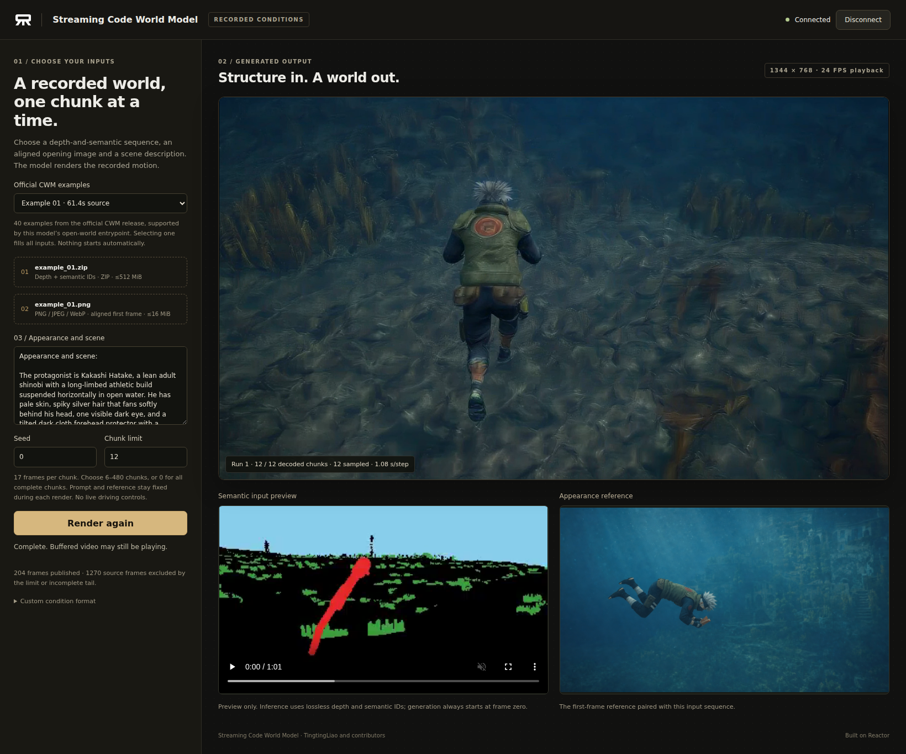

# Streaming Code World Model on Reactor

Render recorded worlds with [Streaming Code World Model](https://github.com/TingtingLiao/streaming-code-world-model), powered by [Reactor](https://reactor.inc). Choose a recorded depth-and-semantic sequence, its opening reference image and a scene description. Generated video arrives one chunk at a time in the included browser demo.



What this integration adds:

- A Reactor service launched with `reactor build` and `reactor run`.
- A small browser client with 40 paired CWM examples, custom inputs, progress, and explicit Start/Stop controls.
- Streaming inference using the released four-step DMD checkpoint, BF16 transformer and six-chunk sliding history. The original sampling order, KV updates and RoPE rotation are preserved.

## What you need

- Linux, Docker, the [NVIDIA Container Toolkit](https://docs.nvidia.com/datacenter/cloud-native/container-toolkit/latest/install-guide.html), and one NVIDIA B200. The tested comparison peaked at approximately 123 GiB of PyTorch-allocated GPU memory; allow additional CUDA overhead.
- At least 256 GB of host RAM. The text encoder resides on CPU between renders.
- Approximately 126 GiB for the downloaded weights and expanded examples, plus space for Docker layers, download caches and browser assets.
- Python 3.12 for preparing browser assets, and Node.js 20+ with npm for the client.

Run the following commands from this directory, alongside `reactor.yaml`.

## 1. Install the Reactor CLI

```sh
brew install reactor-team/tools/reactor-cli
```

For Linux without Homebrew, use the [CLI installation guide](https://docs.reactor.inc/deploy/platform/installation). **Check:** `reactor version` prints a version.

## 2. Start the model

```sh
reactor validate
reactor build
reactor run --gpus device=0 --port 8080 --weights ./weights
```

Choose a free GPU on shared machines. The first start downloads the pinned MiniMax-H3 components, Qwen processor, released streaming DMD LoRA and the 40-example CWM dataset into the mounted weights directory. Later starts reuse those files. A read token can be forwarded with `-e HF_TOKEN` when needed; keep credentials out of source files.

Loading the model takes several minutes after downloading. Leave this terminal running; `Ctrl+C` stops the container. Rebuild after changing the adapter or manifest.

**Check:** in another terminal, wait for `"state":"available"`:

```sh
curl -s http://localhost:8080/health
```

Docker image storage and model weights are separate. Configure the Docker data directory and use `--weights /path/to/large-volume/weights` if the system disk is small; use that same weights directory in the next step.

## 3. Prepare the example gallery

After the service has materialized the examples, create their browser previews from the same files. This preparation uses CPU only:

```sh
python3.12 -m venv .venv
. .venv/bin/activate
pip install numpy Pillow av
python prepare_examples.py --release-root ./weights
```

**Check:** `demo/public/examples/index.json` contains 40 entries. The generated previews and condition archives are ignored by Git. The model reads built-in conditions directly on the server; selecting a built-in example does not send its large archive through your browser.

## 4. Open the client

In another terminal, from this directory:

```sh
cd demo
cp .env.example .env
npm ci
npm run dev
```

Open **http://localhost:3000**, click **Connect**, choose an **Official CWM example**, and click **Start rendering**. Choosing an example fills its conditions, reference and prompt together. Selecting or uploading inputs alone never starts generation. No example is selected automatically.

The client reads `VITE_REACTOR_URL` from `demo/.env`; the default is `http://localhost:8080`. Restart the frontend after changing this address. A semantic preview is provided for inspection; inference always starts at the sequence's first frame.

### Remote GPU machines and SSH

The browser needs both the HTTP endpoint and a WebRTC media path. SSH port forwarding carries TCP; forwarding the HTTP port alone does not carry WebRTC UDP. Docker host networking alone does not solve this either. Configure an authenticated TURN-over-TCP relay reachable by the browser and model, advertise it through Runtime's ICE configuration, and forward its TCP port along with the frontend and HTTP ports. Keep relay credentials and machine-specific network settings outside this repository. See [the demo guide](demo/README.md).

## Inputs and controls

| Control | Effect |
| --- | --- |
| Official CWM example | Select one of 40 recorded sequences with its paired opening image and static prompt. |
| Conditions ZIP | Upload lossless depth/semantic-ID pairs, up to 512 MiB. |
| Reference image | Upload an aligned first frame: PNG, JPEG or WebP, up to 16 MiB. |
| Appearance and scene | Describe the initial appearance. The prompt remains fixed for this render. |
| Seed | Seed for a fresh render, from 0 to 2147483647. |
| Chunk limit | Render 6–480 complete chunks, or use 0 for all available complete chunks up to 480. |
| Start rendering / Render again | Begin a fresh run with the selected inputs. |
| Stop rendering | Stop at the next step boundary, clear queued video and release this run's caches. |

The released open-world path uses a static caption and removes any `Protagonist action timeline:` section. This integration follows that behavior. Choose new text before starting a fresh render. Live prompt editing, live driving and CARLA simulation are outside this recorded-input version.

### Custom condition format

The ZIP contains consecutive pairs, beginning at frame zero, directly at its root or under `conditions/`:

```text
000000.depth.f32
000000.semantic_id.png
000001.depth.f32
000001.semantic_id.png
...
```

Depth files are **336 × 192 little-endian float32 distances in metres**. Semantic files are **336 × 192 grayscale PNGs with class IDs 0–11**, using the original [CWM condition convention](https://github.com/buaacyw/code-world-model). At least 102 frames are required. Pair them with an aligned opening image and scene prompt; the reference is fitted to 1344 × 768 using the native resize. Unsupported, missing, duplicate or unsafe files are rejected before replacing the current run. Expanded archives are limited to 3 GiB.

An ordinary RGB or colour-semantic MP4 does not retain the required depth and semantic-ID data. The MP4 displayed by the gallery is a preview, while the service consumes the lossless pairs. Incomplete final chunks and frames excluded by your limit are reported in the UI.

## Streaming and timing

Each sampling call generates **five latents / 17 frames**. The native decoder uses two latents of lookahead and a five-frame boundary blend, so the first video chunk arrives after the second sampling step. Later calls publish one 17-frame chunk; a final decode-only step flushes the last chunk. The service does not wait for the entire video to finish.

Playback/export follows the native **24 FPS** timing. Generation on one B200 is slower than that rate, so the live player can pause between chunks. The initial step also encodes all selected conditions and text; this preparation takes longer than subsequent steps. Reducing the chunk limit shortens input preparation without shortening the six-chunk model history.

The B200 compatibility path selects the upstream PyTorch SDPA attention option, including the token refiner; masked prefill retains upstream FlexAttention. FP8, reduced denoising steps and shortened history are not enabled. This is the first-stage faithful port, with acceleration left for separate work.

## Validation

A fixed-seed, fixed-prompt comparison on one B200 ran the original sampler and the adapter for **12 consecutive chunks / 204 frames**, spanning KV-window eviction and RoPE rotation. Generated latents and decoded RGB arrays matched exactly: maximum absolute difference **0** for both. The comparison used identical prepared inputs and the same B200-compatible attention settings; it does not establish equality for every input, device or lossy encoded video.

Once the six-chunk window was full and kernels were warm, denoising took about **5.74 seconds per 17-frame chunk (2.96 generated FPS)**. This excludes input preparation, VAE decode and transport. The displayed step duration includes generation and decode, and is separate from playback FPS.

In the actual Runtime service, full-window steps including VAE decode took approximately **6.82 seconds / 17 frames (2.49 generated FPS)** on the tested example. Preparing its 12-chunk input and sampling the first chunk took about **152 seconds**; the first video followed one sampling step later. These timings depend on input length, prompt and hardware.

A built-in example and a custom-upload sequence each completed 12 chunks through `reactor run` and the browser client over TURN/TCP, followed by two successful disconnect/reconnect cycles. These tests cover representative inputs; all 40 examples have been checked for input preprocessing, not exhaustively generated on GPU.

CPU tests exercise real Runtime hooks, source acknowledgement, refusal, error propagation, session cleanup, model-half reset, example selection and upload validation:

```sh
pip install reactor-runtime==3.8.2 numpy Pillow pytest
pytest -q tests
```

## More

- [Reactor Runtime](https://github.com/reactor-team/reactor-runtime) and [SDK documentation](https://docs.reactor.inc/sdk-reference/using-the-sdk).
- `GET /schema` describes `start`, `start_example`, `stop` and the `state_update` broadcast. The included client uses the official JavaScript SDK in local mode. Hosted authentication requires a backend token exchange.
- `streaming_cwm.py` owns commands, session state and Runtime hooks. Its `generate()` forwards a frozen CPU input to `DistributedRunner` on one GPU. `streaming_cwm_model.py` owns run identity; the backend owns weights, conditioning and caches; `streaming_cwm_sampling.py` exposes the native chunk boundary and incremental decoder. The model half imports no Runtime APIs.
- `reactor.yaml` pins Runtime and the three upstream source revisions. Build installs those sources and applies CWM's own required Musubi patches. Native training/inference files in this checkout remain unchanged.

## Credits and usage terms

Thanks to [Rising0321](https://github.com/Rising0321) for porting Streaming Code World Model to Reactor. The model, training and released inference implementation are the work of Tingting Liao, Guangyi Liu and the upstream contributors, building on CWM, MiniMax-H3, Musubi, CARLA and Qwen3-VL.

Model weights and dependencies retain their respective usage terms. The pinned Streaming Code World Model repository and LoRA model card do not declare an explicit licence; confirm redistribution and deployment permission with their authors before publishing or deploying a derivative. This integration does not grant rights to those assets.
